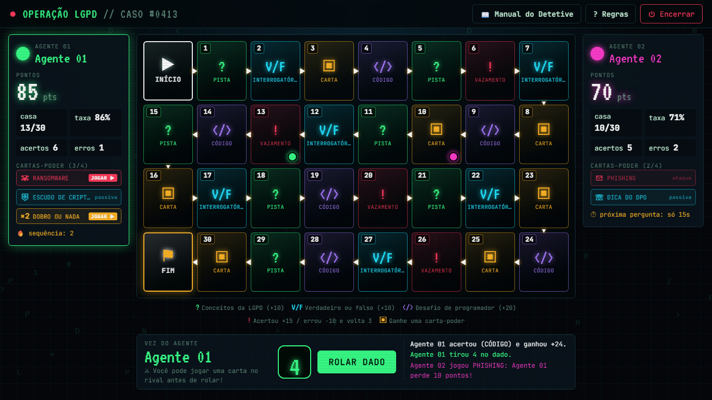
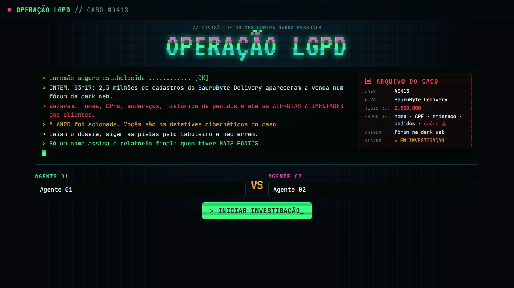
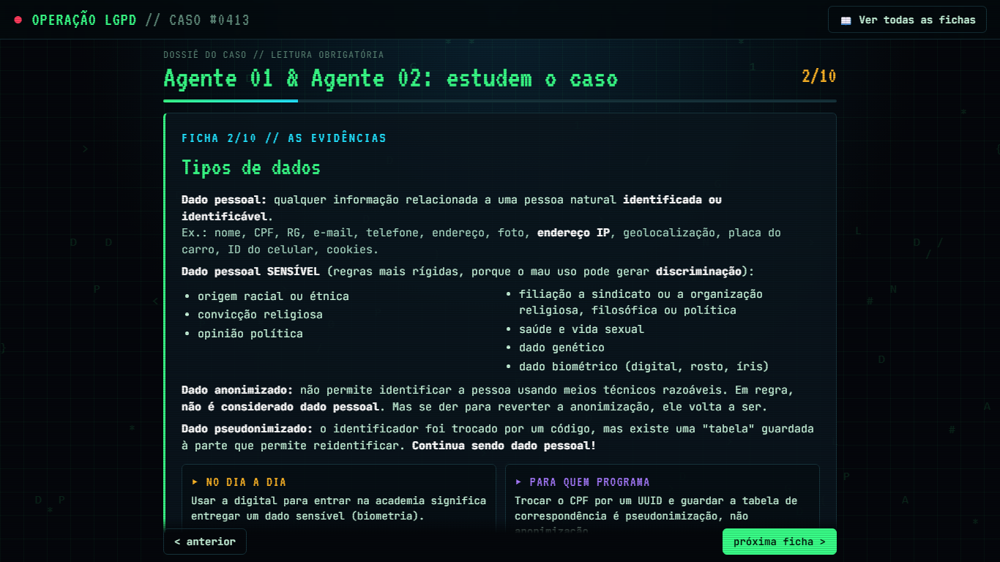
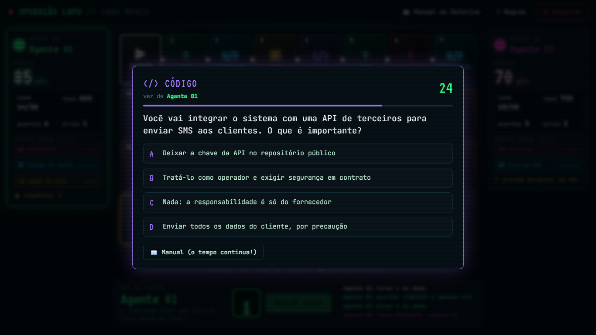
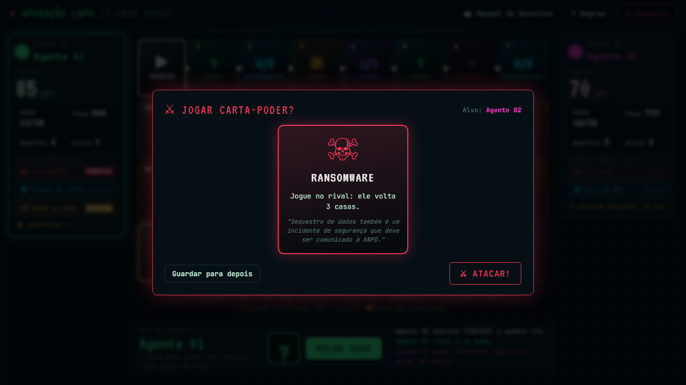
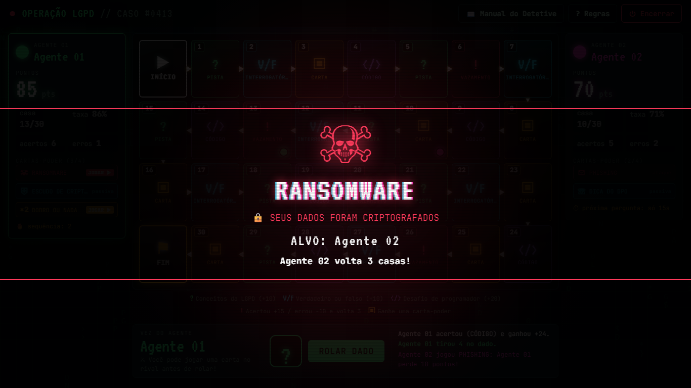
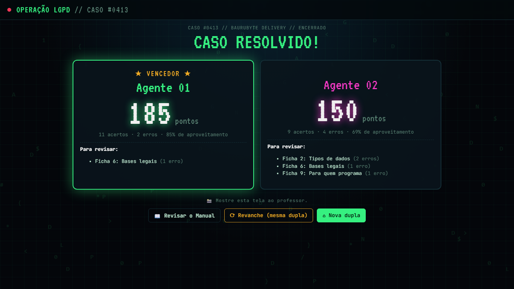

# 🕵️ Operação LGPD

**Um jogo de tabuleiro investigativo, com visual hacker, para aprender a LGPD (Lei Geral de Proteção de Dados) jogando.**

Dois alunos, um computador, um vazamento de 2,3 milhões de cadastros para investigar. Quem entender melhor a lei faz mais pontos e assina o relatório final.




---

## ⚡ Comece em 30 segundos

1. Clique no botão verde **`<> Code` → `Download ZIP`** aqui no GitHub.
2. Descompacte a pasta.
3. Dê dois cliques no arquivo **`index.html`**.

Pronto: o jogo abre no navegador. **Não precisa instalar nada, nem de servidor ou banco de dados.** A internet é usada só para carregar as fontes; sem ela, o jogo funciona com fontes padrão.

> 💡 **Quer um link para mandar aos alunos?** Ative o GitHub Pages (instruções [mais abaixo](#-publicar-como-site-github-pages)) e o jogo fica online, com endereço próprio.

---

## 🎯 O que é

O **Operação LGPD** é uma atividade gamificada para apresentar a LGPD (**Lei nº 13.709/2018**) a quem conhece só a sigla. O conteúdo foi pensado para dois públicos ao mesmo tempo:

- 👤 **qualquer pessoa**: o que é dado pessoal, quais são seus direitos, o que fazer quando há um vazamento;
- 💻 **quem programa**: como guardar senhas, minimizar dados, cuidar de logs e URLs, privacy by design, etc.

A história: a empresa fictícia **BauruByte Delivery** teve nomes, CPFs, endereços e até **dados de saúde** dos clientes vazados. Os alunos são detetives cibernéticos e precisam resolver o caso.

---

## 🎮 Como funciona uma partida

| Etapa | O que acontece |
|---|---|
| **1. Cadastro** | Os dois alunos digitam seus nomes (Agente 01 vs Agente 02). |
| **2. Dossiê** | Leitura obrigatória de **10 fichas curtas** com os conceitos da LGPD. |
| **3. Tabuleiro** | Na sua vez, o aluno rola o dado, anda e enfrenta o desafio da casa. São 30 casas em zigue-zague, do **INÍCIO ▶** ao **FIM ⚑**. |
| **4. Placar** | Vence quem tiver **mais pontos**, não quem chega primeiro. |

### As casas do tabuleiro

| Casa | Desafio | Pontos |
|---|---|---|
| **?** PISTA | Pergunta sobre conceitos da LGPD | +10 |
| **V/F** INTERROGATÓRIO | Verdadeiro ou falso | +10 |
| **</>** CÓDIGO | Desafio para programadores | +20 |
| **!** VAZAMENTO | Acertou: contém o incidente. Errou: perde pontos e volta 3 casas | +15 / −10 |
| **▣** CARTA | Ganha uma carta-poder | — |

- ⏱ Cada pergunta tem **30 segundos**. Responder rápido dá **até +5 de bônus**.
- ❌ Errou? **Volta 1 casa**. Depois de cada resposta aparece a **explicação** e um link para a ficha do assunto.
- 📖 O **Manual do Detetive** pode ser consultado a qualquer momento, **mas o tempo continua correndo**.
- 🔥 **Combo:** a cada 2 acertos seguidos, o aluno ganha uma carta-poder.
- ⚑ Quem chega primeiro ao FIM ganha +30, e o rival tem **uma última jogada**, sempre com pergunta.

### Cartas-poder

Cada agente começa com 1 carta de ataque. Na sua vez, **antes de rolar o dado**, pode jogar quantas cartas quiser no rival.

| Carta | Efeito |
|---|---|
| ☠ **Ransomware** | O rival volta 3 casas |
| ✉ **Phishing** | O rival perde 10 pontos |
| ⌁ **Ataque DDoS** | O rival perde a próxima vez |
| ⏱ **Auditoria Relâmpago** | A próxima pergunta do rival tem só 15 s |
| ☻ **Engenharia Social** | Rouba uma carta da mão do rival |
| ×2 **Dobro ou Nada** | Sua próxima pergunta vale o dobro |
| ⛨ **Escudo de Criptografia** | Bloqueia sozinho um ataque ou uma penalidade de vazamento |
| ⇄ **Roubar a Pista** | Se o rival errar, você responde e fica com os pontos |
| ☏ **Dica do DPO** | Elimina 2 alternativas erradas |

Cada carta traz uma frase ligando o efeito a um conceito real de segurança ou de LGPD.

---

## 📚 O que os alunos aprendem

As 10 fichas do dossiê (e as 62 perguntas do jogo) cobrem:

1. **O que é a LGPD**: abrangência, exceções e o papel da ANPD
2. **Tipos de dados**: pessoal, sensível, anonimizado e pseudonimizado
3. **Quem é quem**: titular, controlador, operador e encarregado (DPO)
4. **Tratamento e ciclo de vida**: o que é tratamento e quando ele termina
5. **Os 10 princípios**: finalidade, necessidade, segurança, prevenção...
6. **Bases legais**: as 10 hipóteses, e por que o consentimento não é a única
7. **Consentimento e crianças**
8. **Direitos do titular**: acesso, correção, eliminação, portabilidade, revisão de decisões automatizadas
9. **Para quem programa**: hash de senhas, minimização, logs, HTTPS, dados de teste, RIPD
10. **Incidentes e sanções**: comunicação à ANPD e multas de até R$ 50 milhões

No placar final, cada aluno vê **quais fichas precisa revisar**, com base nos erros que cometeu.

---

## 👩‍🏫 Para professores

- ⏰ **Duração:** cerca de 40 min (10 min de dossiê e 30 min de jogo).
- 👥 **Formato:** duplas no **mesmo computador**, revezando a vez.
- 🏆 **Resultado:** a tela final mostra nome e pontos de cada um. Peça uma foto ou anote.
- ⏻ **O tempo da aula acabou?** O botão **Encerrar**, no topo, gera o placar na hora.
- 🔄 **Página recarregada sem querer?** A partida fica salva no navegador. Na tela inicial, clique em **"Continuar a partida salva"**.
- 🖥️ **Telas:** o layout se ajusta a 16:9 (laboratório) e a telas mais quadradas (notebooks 4:3 e 3:2), sem rolagem.

### ✏️ Trocar ou adicionar perguntas

Todo o conteúdo está em **`js/conteudo.js`**: fichas, perguntas e cartas. Para criar uma pergunta de múltipla escolha:

```js
{ q: "Texto da pergunta?",
  o: ["Alternativa CORRETA", "Errada 1", "Errada 2", "Errada 3"],  // a 1ª é sempre a correta
  e: "Explicação mostrada depois da resposta.",
  f: 5 }  // número da ficha relacionada (1 a 10)
```

As alternativas são **embaralhadas** na tela automaticamente.

> ⚠️ **Dica de ouro:** mantenha as alternativas com **tamanhos parecidos**. Se a correta for sempre a mais longa (ou a mais curta), os alunos descobrem o padrão rapidinho!

---

## 🌐 Publicar como site (GitHub Pages)

1. No repositório, vá em **Settings → Pages**.
2. Em **Branch**, escolha `main` e a pasta `/ (root)` e clique em **Save**.
3. Em 1 ou 2 minutos, o jogo estará em `https://SEU-USUARIO.github.io/NOME-DO-REPOSITORIO/`.

---

## 📸 Prints

| Tela inicial | Dossiê do caso |
|---|---|
|  |  |

| Pergunta com cronômetro | Carta-poder |
|---|---|
|  |  |

| Ataque ao rival | Placar final |
|---|---|
|  |  |

---

## 🗂️ Estrutura do projeto

```
├── index.html          # página única do jogo
├── css/style.css       # visual (tema terminal hacker)
├── js/conteudo.js      # fichas, perguntas, cartas e tabuleiro  ← edite aqui
├── js/efeitos.js       # efeitos visuais (partículas, alertas, ataques)
├── js/jogo.js          # regras e lógica do jogo
└── docs/prints/        # imagens deste README
```

É HTML, CSS e JavaScript puros: sem frameworks, sem build e sem backend. Os dados da partida ficam só no `localStorage` do navegador.

---

## 🙌 Créditos

Criado por **Prof. Rodrigo Campos (IFSP)** para a disciplina de **Segurança Digital** do curso **Técnico em Informática do IFSP Bauru**.

- A empresa **BauruByte Delivery** e o vazamento são **fictícios**.
- O conteúdo tem fins **educacionais**, é baseado na Lei nº 13.709/2018 e em normas da ANPD, e **não substitui orientação jurídica**.

Outros professores podem usar, adaptar e compartilhar à vontade. Se o jogo for útil para você, deixe uma ⭐ no repositório!

## 📄 Licença

Distribuído sob a licença **MIT**. Veja o arquivo [LICENSE](LICENSE).
